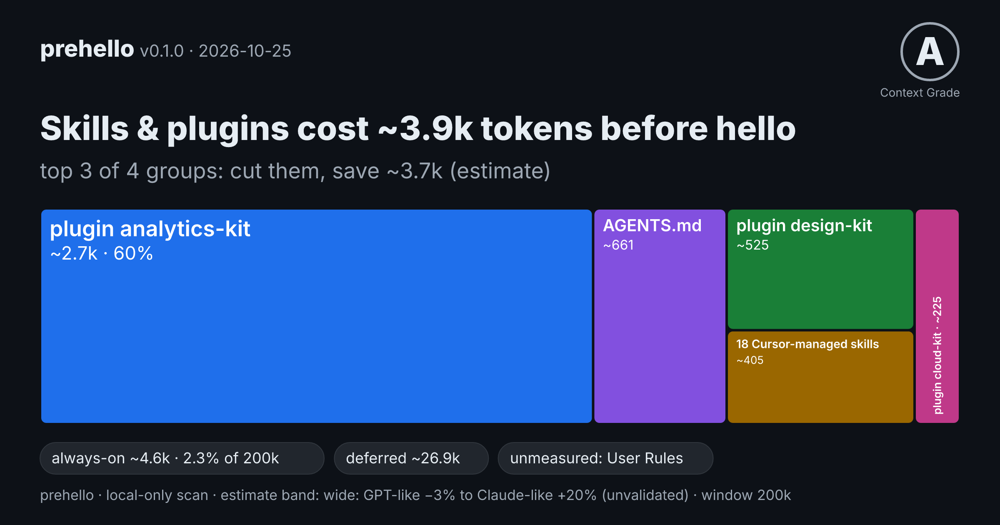
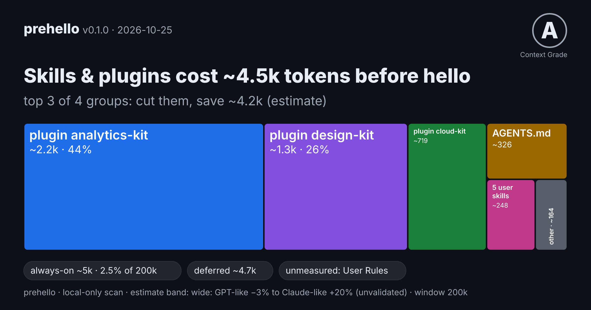
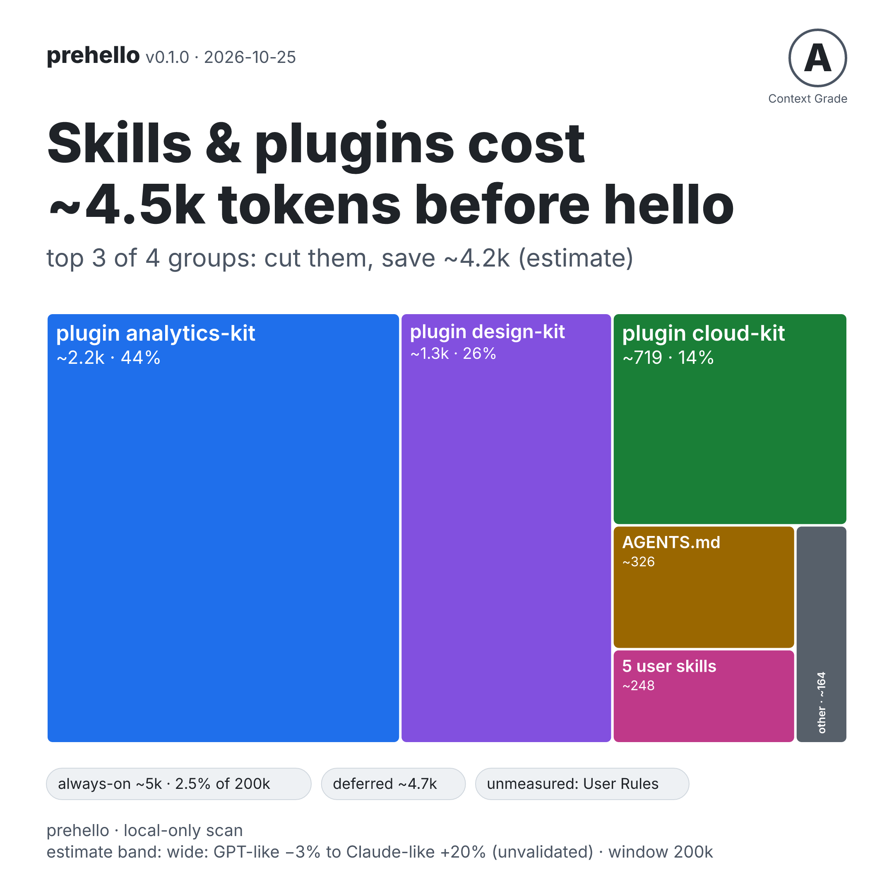
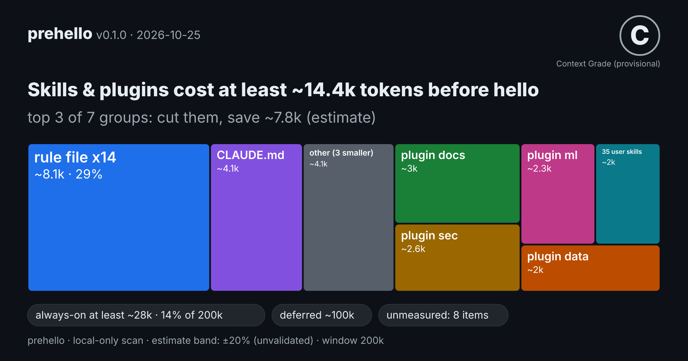

<h1 align="center">prehello</h1>

<p align="center"><b>See what your coding agent loads before you say hello, and what you could cut.</b></p>

<p align="center">
  <a href="https://github.com/PIYUSH-KUMAR1809/prehello/actions/workflows/ci.yml"></a>
  <a href="LICENSE"></a>
  
  
</p>

<p align="center">
  
  <br>
  <sub>A share card (<code>--card=card.png</code>). Sample data shaped like a real Cursor setup, not a real machine.</sub>
</p>

Every Claude Code, Cursor or Codex session starts with a pile of rules, skills, plugin listings and MCP servers already sitting
in the context window, before you type a word. **prehello** scans your repo and your home-directory agent config and tells you
**how many tokens that is, which plugin or skill folder is responsible, and roughly what removing the top few would save.**

- **Local and read-only.** No network, no telemetry, no API key, no child processes. Nothing leaves your machine.
- **Honest numbers.** Every count is an estimate (`~`). What it cannot measure is listed, never shown as 0.
- **Actionable.** A ranked "what to cut" list, a share card, a Markdown report, SARIF for code scanning, and a `--max-tokens` CI gate.

## Try it

```sh
git clone https://github.com/PIYUSH-KUMAR1809/prehello.git
cd prehello
npm ci && npm run build
node dist/cli.js ~/code/your-project                  # scan a project plus your user-level agent config
node dist/cli.js                                      # or: scan the current folder
node dist/cli.js ~/code/your-project --card=card.png  # also write a PNG share card
```

Needs Node 18 or newer, on Linux, macOS or Windows. **npm release:** not published yet; once it is, this becomes `npx prehello`.

## What it prints

A real run on bundled **fixture** data (`test/fixtures/plugin-heavy`: three invented plugins plus a few skills), not anyone's real numbers:

```text
prehello 0.1.0 · this folder + user config · window 200k
Token counts are ESTIMATES (o200k BPE with per-agent scaling priors), shown with
~. Not exact for any model.

Before your first message: Cursor ~5k tokens

What to cut (estimates)
  Cursor  skills, plugins and MCP servers add ~4.5k tokens before hello: 90% of
          the measured always-on total, in 4 groups.
          Top 3 groups = 94% of that. Removing them would save about 4.2k tokens
          (2.1% of a 200k window); estimate, not a promise.
           1. plugin analytics-kit (40 skills)               ~2.2k    44%
           2. plugin design-kit (24 skills)                  ~1.3k    26%
           3. plugin cloud-kit (14 skills)                    ~719    14%

Measured vs. not measured (always-on items)
  Cursor  measured 4 of 4 (100%): 2 skills listings, 1 instruction file, 1 rule
...
```

That is the first screen. Below it come a per-agent breakdown (always-on / conditional / deferred / on-demand), what could not be measured, and a
Context Grade (a heuristic of this tool, not a standard). The full output is under [Reference](#reference) (collapsed).

> **Read the numbers as "what YOUR config adds".** The agent's own built-in system prompt and built-in tool definitions are **not** counted:
> they are usually the largest fixed chunk of the context window and are not on disk, so no static scanner can see them. prehello's total is the part
> *you* control. For the exact live total in one Claude Code session, use `/context`.

### On one real machine

The author's own Cursor setup, one run of prehello 0.1.0 on 2026-10-25. **One machine, estimates, not reproducible from this repo.**

| What | Estimate, before hello |
| --- | --- |
| Skills, plugins and MCP servers | **at least ~14.3k tokens** (a lower bound: items prehello cannot measure, such as Cursor User Rules, are not in it) |
| Cut list, top 3 of 6 groups | `plugin posthog` ~10.3k (72%), `plugin figma` ~1.7k, 18 Cursor-managed skills ~1.3k: removing them would save about **~13.2k** |

Almost all of it is skill listings, mostly from one plugin. Every enabled skill puts its name and description in the context on every session,
whether you use it or not. That is what the cut list is for, and removing a plugin you actually use costs you the plugin.

## Outputs

| You want | Run |
| --- | --- |
| The report in the terminal | `node dist/cli.js` (`--verbose` for per-item evidence) |
| A share card (PNG or SVG) | `--card=card.png` or `--card=card.svg` (write the name with `=`) |
| Something to paste into an issue, PR or Slack | `--markdown` (or `--markdown=report.md`, `--markdown-compact` for a PR comment) |
| GitHub code scanning / IDEs | `--sarif=prehello.sarif` |
| Machine-readable | `--json` (add `--redact` before sharing it: no paths or names) |
| A budget gate in CI | `--max-tokens 16k` (exit code 2 above it) |
| Suggestions, changing nothing | `--fix` (dry run) |
| Count Cursor "User Rules" you paste in | `--paste-user-rules rules.txt` |
| Also count agent files inside test-fixture folders | `--include-fixtures` (skipped by default; see [Test-fixture folders](#reference)) |

`node dist/cli.js --help` lists every flag. PNG cards need the optional package `@resvg/resvg-wasm`; if it is missing, prehello prints how to install it
and exits 1 without a stack trace, and the SVG card and everything else keep working.

## Agents covered

Claude Code, Cursor, Codex, and plain `AGENTS.md` files. Details of what is scanned for each are in the [reference](#reference). Not yet: Gemini CLI, Windsurf, Copilot, Cline.

## FAQ

**Does it send anything anywhere?** No. No network, no telemetry, no API key, no child processes. A test runs the CLI with a guard that blocks and records any
network, DNS or child-process attempt. It writes only the output files you name (`--card=`, `--json=`, `--markdown=`, `--sarif=`).

**Is the token count exact?** No, and it says so. It counts with the o200k tokenizer and applies a per-agent factor. The factors for Claude and Cursor are
**priors, not validated** against those vendors' tokenizers, so every total carries an error band and a `~`.

**Why is my total smaller than what `/context` shows?** `/context` also sees the built-in system prompt, built-in tool definitions and the conversation. prehello only sees what is on disk.

**Why not just use `/context`?** If you only use Claude Code and want the true number for one live session, do. prehello works before a session, covers Cursor and Codex too,
runs in CI, and ranks *which plugin or skill folder* to remove.

**Does it start my MCP servers?** No. It lists their names and counts. Sizes come only from a small measured catalog (`spec/mcp-weights.json`, 7 servers) or a file you give it; every other server stays "unmeasured".

**Does it change my files?** No. `--fix` is a dry run that only prints suggestions.

**Can I trust the Context Grade?** It is a heuristic of this tool, not a standard. It is capped at B and marked provisional when something that always loads could not be measured. `node dist/cli.js explain grade` prints the rubric. `--no-grade` hides it.

**Why does it say "Skipped N fixture folders"?** A repo that tests agent tooling keeps sample `AGENTS.md`, `CLAUDE.md`, `.cursor/rules` and skills under `test/fixtures/` and similar. No agent loads those, so prehello skips such folders by default and says how many it skipped (only folders where it found agent files). `--include-fixtures` counts them; scanning a folder that is itself inside a fixtures folder never skips anything.

**Does it work on Windows?** Yes. CI runs the full suite on Ubuntu, Windows and macOS with Node 18, 20 and 22. See [Platforms](#reference).

## Limitations

- Token counts are **estimates**; Claude and Cursor scaling factors are unvalidated.
- The built-in system prompt, built-in tools, Cursor User and Team Rules (unless pasted), claude.ai connectors, hook output and anything injected at runtime are **never measured**.
- Loading rules come from the agents' public docs and announcements, not from their source, and were **not re-verified against live installs**; items where sources disagree are labelled `assumed`.
- Only three agents plus `AGENTS.md` are covered, and MCP server sizes exist for just 7 servers.

Full list: [reference](#reference).

## How it differs

Several small tools look at neighbouring problems. As of 2026-10-25, from each project's own npm, PyPI or docs page; **I read them, I did not run them**.
They overlap with prehello in places, so if one of them fits better, use it.

- **`/context`** (built into Claude Code): per Anthropic, it visualizes what is currently loaded into the context window and where it is being spent, for the live session.
- **ccusage**: its npm description is "Analyze coding (agent) CLI token usage and costs from local data", so it is about what past sessions used and cost, not what loads before a session.
- **ctxlint**: a linter for AI agent context files and MCP configs, catching broken paths, wrong commands and leaked secrets.
- **ctxweight** (npm, v0.1.0): describes itself as an X-ray of your agent's context, with health checks and token cost in one command.
- **ctxaudit**: audits "the invisible context tax" from skills, rules and instruction files (v0.1.0, PyPI).

What prehello focuses on: a per-plugin / per-skill-folder **cut list**, **unmeasured is never 0** (totals become lower bounds), a confidence label on every item
(`documented`, `observed`, `assumed`), a share card that holds no paths or file contents, and a CI gate. What it does **not** do: live sessions, dollar cost,
linting your instructions against your code, or exact token counts.

## Reference

Long-form details, collapsed. Everything here describes the current CLI. Commands below say `prehello`; from a source checkout run `node dist/cli.js` instead (after the npm release, `npx prehello`).

<details>
<summary><b>Full sample output (fixture, not a real machine)</b></summary>

```text
prehello 0.1.0 · this folder + user config · window 200k
Token counts are ESTIMATES (o200k BPE with per-agent scaling priors), shown with
~. Not exact for any model.

Before your first message: Cursor ~5k tokens

What to cut (estimates)
  Cursor  skills, plugins and MCP servers add ~4.5k tokens before hello: 90% of
          the measured always-on total, in 4 groups.
          Top 3 groups = 94% of that. Removing them would save about 4.2k tokens
          (2.1% of a 200k window); estimate, not a promise.
           1. plugin analytics-kit (40 skills)               ~2.2k    44%
           2. plugin design-kit (24 skills)                  ~1.3k    26%
           3. plugin cloud-kit (14 skills)                    ~719    14%

Measured vs. not measured (always-on items)
  Cursor  measured 4 of 4 (100%): 2 skills listings, 1 instruction file, 1 rule

Top offenders (always on, estimates)
   1. AGENTS.md                                          326   6.6%  ████████████
   2. .cursor/rules/always.mdc                           164   3.3%  ██████
   3. skill "analytics-task-12"                           59   1.2%  ██
   4. skill "analytics-task-26"                           59   1.2%  ██
   5. skill "analytics-task-3"                            59   1.2%  ██

── Cursor ─────────────────────────────────────────────────────────────  Grade A
   estimate model: o200k; model unknown, so midpoint of GPT-like (×1.0) and
      Claude-like (×1.5) priors; band wide: GPT-like −3% to Claude-like +20%
ALWAYS ON before hello   ~5k tokens (3.9k–7.1k)  ≈ 2.5% of 200k
   Skills listing (78 skills from 3 plugins)      4,226     85%  ████████████
   AGENTS.md                                        326    6.6%  ▌
   Skills listing (5 user skills)                   248    5.0%  ▌
   .cursor/rules (alwaysApply)                      164    3.3%  
DEFERRED (stub now, body on demand)   ~4.7k tokens (3.6k–6.7k)
   Skill bodies (78 skills from 3 plugins)      4,383     94%  ████████████
   Skill bodies (5 user)                          280    6.0%  ▌
   not measurable from disk: User Rules and Team Rules (stored in Cursor, not on
      disk; paste them with --paste-user-rules to count them) · built-in system
      prompt and tools · plugin install state (3 plugins found under
      ~/.cursor/plugins)

Never measured: the agent's built-in system prompt and built-in tool
definitions; server-side / org rules, Cursor User & Team Rules, claude.ai
connectors; MCP servers whose tools are only known at runtime (no server is
started by default); files outside the scanned locations; anything the agent
injects dynamically (hooks, memory/RAG plugins).
Context Grade (Cursor): A — heuristic, not a standard. See: prehello explain
grade
```

</details>

<details>
<summary><b>How to read the output</b></summary>

- `~` means *estimated*. Ranges in brackets are the error band of the estimation model, not a confidence interval of truth.
- **Measured vs. not measured.** Every agent gets a line saying how many always-on items were measured and which were not
  (for example MCP servers whose tool schemas only exist at runtime). `unmeasured` is **never shown as 0**.
- If any always-on item is unmeasured, or the scan stopped at its budget, the always-on total becomes a **lower bound** (`≥` in the terminal, "at least" on the card)
  and the grade is **capped at B and marked provisional**. If nothing could be measured there is **no grade at all** and the output says so, instead of a flattering "A".
- **Top offenders** ranks the biggest always-on items across agents (shown when there are at least three).
- An agent that is installed but has nothing on disk gets an explicit "installed, but nothing that loads before hello was found.
  This is NOT a score of 0" message plus where prehello looked. An empty machine gets a "what I looked for / what to try" screen.
- Agents found only inside the repo (for example an `AGENTS.md` committed by a teammate, with no sign you use that agent)
  are collapsed and excluded from the headline, card and grade (use `--agent` to include them).
- **Running it from a folder that is not a project** (no `.git`, no agent files, for example your home folder) and with a huge tree:
  prehello warns and does **not** print token totals for random nested files it happened to find first.

</details>

<details>
<summary><b>Test-fixture folders (<code>--include-fixtures</code>)</b></summary>

The project walk (nested `AGENTS.md` / `CLAUDE.md`, `.cursor/rules`, `.cursor/skills`, `.claude/skills`, `.agents/skills`) **skips test-fixture folders by default**, for every agent, so a
repository like prehello's own does not list its sample files as "conditional" context.

| Folder name (any depth below the scanned folder, any letter case) | Skipped |
| --- | --- |
| `fixtures`, `__fixtures__`, `fixture`, `testdata`, `test-data`, `__mocks__`, `__snapshots__` | always |
| `snapshots`, `golden`, `goldens` | only below a `test`, `tests`, `__tests__`, `spec`, `e2e` or `cypress` folder |

- **Never skipped:** the scanned project's own top-level files, files found by walking *up* from the scanned folder, user-level config, and anything when the scanned folder is itself inside such a folder (so `prehello test/fixtures/x/project` works as before).
- **Said out loud:** when at least one skipped folder held agent files, the terminal report, Markdown (full and compact) and SARIF (`runs[0].properties.prehello.fixtureFoldersSkipped`) carry one line / one number, never a path. `--json` gets `scan.fixturesSkipped` (a count; the field is absent when it is 0, so the JSON is otherwise unchanged). It is not a warning and does not change the exit code. Folders that held no agent files are not counted; looking inside a skipped folder to count it is bounded and reads no file.
- `--include-fixtures` turns the skip off.

</details>

<details>
<summary><b>Share cards (SVG and PNG), sample cards and how PNG works</b></summary>

`--card=file.svg` or `--card=file.png` (the extension picks the format; `--card` alone writes `prehello-card.svg`, or `.png` with
`--card-format png`). **Write the file name with `=`: `--card=card.png`.** `--card card.png` (a space) is not accepted: the name would be read as the
project folder, so prehello stops with a hint before scanning. A card holds the same groups as the "What to cut" list on its treemap
(`plugin <name>`, `18 Cursor-managed skills`, `MCP server <name>`), plus generic labels for your instruction files and rules
(`CLAUDE.md`, `rule file x14`), counts, the version and a date. Small tiles are merged into `other (N smaller)`. It never contains paths or file contents.
**Plugin and MCP server names are on the card by default** (they are what makes it readable); add `--card-anonymize` before sharing
if a name is private, and they become `plugin 1`, `MCP server 1`.

| Flag | Meaning |
| --- | --- |
| `--card-headline cut` (default) | Leads with "Skills & plugins cost ~X tokens before hello" and "cut the top N: save ~Y (estimate)". The always-on total is the first chip. |
| `--card-headline total` | Leads with "~X tokens load before hello". |
| `--card-theme dark\|light`, `--card-size og\|square` | Colours; 1200x630 link-preview shape or 1080x1080 square (square puts the headline on two lines). |
| `--card-scale 1\|2` | PNG only. 1 = 1200x630 / 1080x1080, 2 = double that (default, sharper on phones). |
| `--card-anonymize` | Show plugin and MCP server names as `plugin 1` / `MCP server 1` (implied by `--redact`). |
| `--card-agent <id>` | Which agent the card is about (default: the one with the largest measured load). |

The cut headline needs measured always-on data **and** a saving of at least 500 estimated tokens; otherwise the card silently
uses the total headline (and an all-unmeasured setup says "N MCP servers load before hello, token cost unmeasured"). Every
headline is checked before it is drawn: it keeps the `~`, says "estimate", and says "at least" when the total is a lower bound.

**How PNG works.** The card SVG is rasterised locally with [`@resvg/resvg-wasm`](https://github.com/yisibl/resvg-js) (MPL-2.0; one
package, about 2.5 MB, WebAssembly, so no native binaries, no build step and the same result on macOS, Linux and Windows).
It is an *optional* dependency: if it is not installed (for example `npm install --omit=optional`), `--card=x.png` **never crashes**: it prints how to
install it (to stderr), writes no card and exits 1, while everything else you asked for (the report, `--json`, `--markdown`) is still produced, and SVG cards keep working.
The message marks how *this* copy of prehello was installed and lists the other ways:

```text
prehello: PNG cards need the optional package @resvg/resvg-wasm, which is not installed here, so no card was written (...).
Install it, then run the same command again:
  global install of prehello:  npm install -g @resvg/resvg-wasm
  project install:             npm install @resvg/resvg-wasm   (run it in the project that has prehello in node_modules)
  one-off with npx:            npx --package prehello --package @resvg/resvg-wasm -- prehello --card=card.png
Or skip PNG: an SVG card needs no extra install, e.g. --card=card.svg
```

A globally installed prehello also finds a globally installed engine (`npm install -g @resvg/resvg-wasm`, checked with the npm global layout). The text is drawn with a font that ships inside prehello
(three weights of [Inter](https://github.com/rsms/inter), subsetted to about 31 KB each, SIL OFL 1.1, licence in `assets/fonts/OFL.txt`).
System fonts are never used, so the glyphs are the same on every machine, and a test checks that every character on a card exists in those fonts.
The PNG carries a `Software: prehello <version>` text chunk, which is how prehello recognises its own file before replacing it.

Sample cards (regenerate with `node scripts/make-sample-cards.mjs docs` after `npm run build`). **These are made from test-fixture
and synthetic data, not from a real machine; the numbers are illustrations of the format.**



Square, light theme, same fixture:



A synthetic Cursor setup shaped like a real Mac scan (one big plugin, a small one, 18 Cursor-managed skills). The treemap tiles are the same groups as the headline and the "What to cut" list:


A synthetic "heavy" Claude Code setup (35 own skills, 6 plugins, 14 rules, 8 unmeasured MCP servers), which shows the lower-bound wording:



An SVG version of the first card is in `docs/sample-card-fixture.svg`.

</details>

<details>
<summary><b>Markdown report (<code>--markdown</code>)</b></summary>

`--markdown` prints a report you can paste into a GitHub issue or PR, Slack, or a README; `--markdown=report.md` writes it to a file instead
(the file name must end in `.md` or `.markdown`; the same safe-write rules as `--card` and `--json` apply: no symlinks, no replacing a file prehello did
not write unless `--force`, never a file it scanned). On stdout it *replaces* the terminal report, so it composes with other output files
(`--markdown --json=out.json`), but `--json` and `--fix` cannot share stdout with it. With a file name the normal terminal report still prints.

It contains: a title, the headline (the same cut-first headline as the card: `~` on every estimate, "at least" for lower bounds, an unmeasured item is
"not measured", never 0), per agent a table of what loads before hello, the Context Grade (provisional when something is unmeasured), "What to cut",
a "Measured vs not measured" list, and a footer with the prehello version and "estimates". `--markdown-compact` is the short version for a PR comment
(headline, one line per agent, the first things to cut; it implies `--markdown`). `--agent`, `--window`, `--card-headline` and `--max-tokens` (exit code 2)
behave as everywhere else.

**Privacy.** Same contract as the card: no file paths, no file contents, no findings or warnings text (those name files), no home directory. Plugin, MCP server and skill-folder
*names* are shown (they make the report useful); `--card-anonymize` (alias `--anonymize`, implied by `--redact`) turns them into "plugin 1" / "MCP server 1".
Every name is placed in an inline code span with control and bidi characters stripped, secrets scrubbed and pipes escaped, so a hostile name such as
`](http://evil)`, ``, `@everyone` or a backtick run cannot become a link, HTML, a mention or a broken table. prehello's own text is plain ASCII, so it survives any
console code page.

Example (`--markdown-compact`, test fixture, not a real machine):

```md
## prehello report: what your coding agent loads before you say hello

**Skills & plugins cost ~4.5k tokens before hello**

Cursor: top 3 of 4 groups - cut them, save ~4.2k (estimate).

- **Cursor**: ~5k tokens always on (2.5% of 200k), grade A

Cut first (Cursor, estimates): `plugin analytics-kit` ~2.2k, `plugin design-kit` ~1.3k, `plugin cloud-kit` ~719
```

</details>

<details>
<summary><b>SARIF (GitHub code scanning, IDEs)</b></summary>

`--sarif` prints a [SARIF 2.1.0](https://docs.oasis-open.org/sarif/sarif/v2.1.0/sarif-v2.1.0.html) log on stdout (it *replaces* the terminal report, like `--markdown`);
`--sarif=report.sarif` (or `.sarif.json`) writes it to a file and the terminal report still prints. The same safe-write rules as the other outputs apply, and
`--json`, `--fix` and `--markdown` cannot share stdout with it. `--max-tokens` keeps its exit code (2). The output is validated against the OASIS schema in the test suite.

Rules (stable ids; every rule has help text; there are no documentation URLs, the text is in the SARIF itself):

| Rule | Level | What it reports |
| --- | --- | --- |
| `PH001` | note, warning from 5% of the window | an always-loaded file of 2,000+ tokens (or 1%+ of the window): `CLAUDE.md`, `AGENTS.md`, a rule, `MEMORY.md` |
| `PH002` | note, warning from 5% of the window | a plugin, skills folder or MCP server of 1,000+ tokens before the first message (the "what to cut" groups, up to 10 per agent) |
| `PH003` | warning | always-on context above `--max-tokens` ("at least" when something is unmeasured); only exists with that flag |
| `PH004` | note | always-loaded items that could not be measured: cost unknown, not zero, so totals are lower bounds |
| `PH005` | warning | two context files that are 60%+ the same text |
| `PH006` | note | a file longer than the agent's documented length guideline |
| `PH007` | warning | content the agent silently cuts off (Codex 32 KiB, `MEMORY.md` caps, skill description cap) |
| `PH008` | warning | a file the agent ignores (`AGENTS.md` next to a `CLAUDE.md` for Claude Code; `.md` in `.cursor/rules`) |
| `PH009` | warning | a line that looks like a secret (line number only, **never the value**; a pattern match, so false positives happen) |
| `PH010` | note | a skills listing above the agent's listing budget |
| `PH011` | note | some sources were unreadable or skipped, or the scan hit its budget |

Every number is labelled an estimate (`isEstimate: true`, message text says "estimate"); an unmeasured item never carries a number; `at least` marks a lower bound.
The `properties` bags carry the estimate with its low/high band, the agent and the share of the window. Results for one file are merged across agents.

**Locations and privacy.** A `physicalLocation` is written **only for files inside the scanned folder**, as a relative path against `%SRCROOT%` with `startLine` (the line of the
first possible secret for `PH009`, else 1). So run it from the repository root. User-level items (`~/.claude`, `~/.cursor`, `~/.codex`, managed, plugin, built-in), files that are
symlinks out of the project, odd or secret-shaped file names, and everything when you scan your home folder get a `logicalLocation` with a generic label ("User CLAUDE.md",
"plugin 1") and **no path**. `--redact` drops every file location; `--card-anonymize` / `--anonymize` turns plugin and MCP server names into `plugin 1` / `MCP server 1`.
No file contents, no finding or warning texts (they name user-level paths), no absolute paths and no home directory ever reach the file. GitHub code scanning shows only results that have a file
location; results without one (user-level items, `PH003`, `PH004`, `PH011`) are kept for IDE viewers and other tools.

GitHub Actions, as a non-blocking annotation (add `--max-tokens` if you also want a gate). The snippet uses `npx prehello`, which works once the package is on npm; until then build from source in the job:

```yaml
name: prehello
on: [pull_request, push]
permissions:
  contents: read
  security-events: write   # needed to upload SARIF
jobs:
  context-budget:
    runs-on: ubuntu-latest
    steps:
      - uses: actions/checkout@v4
      - uses: actions/setup-node@v4
        with: { node-version: 20 }
      # a CI runner has no agent config in $HOME, so name the agents whose files in the repo you want scanned
      - run: npx prehello --agent claude-code,cursor,codex --sarif=prehello.sarif || test $? -eq 3
      - uses: github/codeql-action/upload-sarif@v4
        if: always()
        with:
          sarif_file: prehello.sarif
          category: prehello
```

Notes: `|| test $? -eq 3` lets "partial results" through (exit 3) but still fails on a real error (1). Add `--max-tokens 16k` and drop the `|| ...` part if over-budget should fail the job (exit 2);
the SARIF file is still written first. Uploading needs GitHub code scanning (public repos, or GitHub Advanced Security on private ones). This workflow has **not** been run against GitHub code scanning yet.

</details>

<details>
<summary><b>CI: <code>--max-tokens</code></b></summary>

```sh
prehello --max-tokens 16k --quiet || echo "always-on context is over budget"
```

Exit code **2** if the always-on estimate of any agent in use is above the limit (a lower bound that already exceeds it counts; the central estimate is what is compared, not the high end of the band).
The number goes to stderr, so `--json` on stdout stays valid. Exit code 2 wins over exit code 3 (partial results). Not a substitute for a lint: it gates size, not quality.

</details>

<details>
<summary><b>Agents covered: what is scanned</b></summary>

| Agent | What is scanned |
| --- | --- |
| Claude Code | `CLAUDE.md` chain (user → ancestors → project, `@imports`), `AGENTS.md` only when no `CLAUDE.md` is in the tree, `.claude/rules` (path-scoped → conditional), auto-memory `MEMORY.md` (200-line cap), skills (user, project, enabled plugins; listing up front, bodies deferred), plugin commands, subagent listings, MCP servers (`~/.claude.json`, `.mcp.json`, plugins) |
| Cursor | `AGENTS.md`, `.cursor/rules/*.mdc` by mode (always / glob / agent-requested / manual; plain `.md` is flagged as ignored), nested rules and skills as conditional, skills in `.cursor/skills` and the compatible `.claude`/`.codex`/`.agents` skill folders, installed plugins' skills / rules / MCP, MCP servers, pasted User Rules |
| Codex | `~/.codex/AGENTS.md` + `AGENTS.override.md` chain from the repo root to the working directory, 32 KiB cap, shadowed files reported, skills (`.agents/skills` up to the repo root, `~/.agents/skills`, `/etc/codex/skills`, `[[skills.config]]` disabling), MCP servers in `config.toml` |

</details>

<details>
<summary><b>Honest caveats</b></summary>

- **Token counts are estimates.** Counting uses the o200k BPE tokenizer (`gpt-tokenizer`) with a per-agent scaling prior.
  - Codex / OpenAI-family: ×1.0, ±3%.
  - Claude Code: ×1.5 (`--claude-profile legacy` uses ×1.2), ±20%. **The Claude factor and band are priors, not validated against Anthropic's tokenizer.**
  - Cursor: the model is not discoverable from disk, so the estimate is the midpoint between the GPT-like and Claude-like priors, with a wide band. Also **unvalidated**.
  - `--tokenizer heuristic` falls back to chars/3.5 (3.0 for JSON), ±35%.
- **Never measured:** the agent's built-in system prompt and built-in tool definitions, server-side/org rules, Cursor User & Team Rules
  (unless you paste them), claude.ai connectors, hook output, anything injected dynamically (memory/RAG plugins).
- **MCP servers.** Names and counts are always listed. Sizes come only from the bundled catalog (`spec/mcp-weights.json`, 7 servers) or your own `--mcp-catalog`.
  The bundled numbers were **actually measured** with `scripts/measure-mcp.cjs`: each package was installed from npm, started offline in a sandbox with a scrubbed
  environment, and asked for `tools/list`. They are raw o200k counts of the tool-list JSON for the stated version, **not** the exact text any agent injects,
  and tool lists change between versions. Every other server stays "unmeasured". The CLI itself never starts a server. `--no-bundled-catalog` turns the catalog off.
- **Loading rules come from public docs and the agents' own announcements, not from their source code,** and were researched on the date in `spec/*.json`
  (`prehello --about-specs`). They were **not** re-verified against live installs. Where sources disagree the item is labelled `assumed` (see below).
  Treat `ignored`/`truncated` findings as strong hints, not proof.
- **Confidence labels** on every item: `documented` (a public doc says so), `observed` (seen on a real machine), `assumed` (a best guess; stated as such in the notes).
  Examples of `assumed`: how Cursor and Codex format their skills listing and what it costs, Cursor's `~/.cursor/skills-cursor`, Cursor plugin install state,
  nested `.cursor/rules`, and whether Codex loads MCP schemas upfront.
- **The Context Grade is a heuristic of this tool**, not a standard. `prehello explain grade` prints the exact rubric.
- **Windows and macOS:** the full test suite runs in CI on Ubuntu, Windows and macOS with Node 18, 20 and 22, and was green on 2026-10-25 (GitHub-hosted runners only; not tried on a range
  of real Windows consoles, locales or corporate setups). Windows specifics (USERPROFILE home, drive letters, UNC, backslash globs, CRLF/BOM/UTF-16 files, reserved device names, case-insensitive file systems)
  are covered by tests, partly by simulation. Only the three listed agents plus plain `AGENTS.md` are covered.

</details>

<details>
<summary><b>Privacy and safety</b></summary>

- **Local only, read-only.** No network, no telemetry, no API key, no child processes. The scanner reads files; the only files it ever
  writes are those you explicitly request (`--json=<file>`, `--card=<file.svg|png>`, `--markdown=<file.md>`, `--sarif=<file.sarif>`), and it refuses to overwrite a file it scanned.
- **Output files are written defensively.** prehello never writes *through a symlink* (not even with `--force`). It replaces an existing
  file only if that file is a previous prehello output (an SVG or PNG it generated, a Markdown file starting with its `<!-- generated by prehello` marker, JSON whose `tool.name` is `prehello`, or a SARIF file whose driver is `prehello`); anything else needs `--force`.
  Directories, other non-regular files and files with extra hard links are refused (hard links need `--force`). The file is opened with `O_NOFOLLOW` and
  checked again after opening, so a link swapped in at the last moment is not followed. A symlinked *parent directory* is not detected: point `--json=`/`--card=` at a path you mean to write.
- It **never prints file contents** (that includes text passed with `--paste-user-rules`, which is counted and discarded).
  Output contains token counts, file *names/paths*, skill, plugin and MCP server *names*, and line-number locations for findings.
  A line that looks like a secret is reported by location only, never echoed. Terminal control characters in file names are neutralised.
- Terminal and `--json` shorten paths (`~`, `./`) but keep names. **Use `--redact` before sharing a JSON file.** The SVG and PNG cards and the Markdown report contain no paths or file contents
  (no paths, no file contents, no home directory). They do show plugin and MCP server names as treemap tile labels; use `--card-anonymize` to hide those.
- **Resource limits.**
  - A single file over **4 MiB** is skipped and shown as *unmeasured* (exit code 3). That matches Claude Code's documented behaviour of skipping a startup `CLAUDE.md` over 4 MiB entirely;
    for other agents it is a safety cap, not their rule. Binary files and symlinks that leave the project are skipped the same way.
  - **Scan budget:** at most **64 MiB** read in total (deterministic; `--scan-budget-mb`) and **20 s** wall clock (`--scan-budget-ms`, a safety net, the one limit that can vary on a slow disk).
    When a budget is hit the scan stops, prints one "results are PARTIAL" warning, every total becomes a lower bound, the grade is provisional, and `--json` has a non-null `partial`.
  - The directory walk stops at 5,000 entries (depth 8) and says so. Test-fixture folders are not walked by default (`--include-fixtures`), so they do not use up that budget.
- These claims are tested, not just stated: a runtime guard blocks and records any filesystem write, network, DNS, `fetch` or child-process attempt
  while the CLI runs on fixtures; a source scan bans those modules from `src/` and allows write APIs in exactly one file (`src/safe-write.ts`); a network-namespace run is used when the OS allows it; and planted "canary" strings
  prove file contents never reach any output. See `test/safety.test.ts` and `test/sarif.test.ts`. (`scripts/measure-mcp.cjs` is a dev-only helper that is not part of the CLI and not in the package.)

</details>

<details>
<summary><b>Platforms</b></summary>

prehello runs on Linux, macOS and Windows (Node ≥ 18) and prints the same numbers on all three.

- **Home folder.** macOS/Linux: `$HOME`. Windows: `%USERPROFILE%` (Claude Code, Cursor and Codex all take it from the OS; Git Bash's `HOME=/c/Users/me` is not used).
  `CLAUDE_CONFIG_DIR` is honoured everywhere.
- **Machine-wide files.** macOS `/Library/Application Support/ClaudeCode`, Linux `/etc/claude-code`, Windows `%ProgramFiles%\ClaudeCode` (falls back to `C:\Program Files\ClaudeCode`).
  Cursor is detected by `~/.cursor`, `cursor` on `PATH`, `Cursor.app` (macOS) or `%LOCALAPPDATA%\Programs\cursor\Cursor.exe` (Windows).
- **Paths in output** always use forward slashes (`./`, `~/`), on Windows too, so JSON and Markdown never contain backslashes or `C:\Users\...`.
- **Files written by Windows tools** are read correctly: CRLF and a UTF-8 BOM are handled in context files, `--mcp-catalog` and `--paste-user-rules`. A UTF-16 file
  (Windows PowerShell 5's `>` redirection) is reported as "saved as UTF-16, re-save as UTF-8", not as binary.
- **Redirecting output on Windows.** Windows PowerShell 5 re-encodes `prehello --json > out.json` as UTF-16. Use `--json=out.json` or `--markdown=report.md`; prehello writes UTF-8 itself.
  Output files named like a Windows device (`NUL`, `CON`, `COM1`, ...) or containing a `:` stream marker are refused.
- **Console.** The legacy Windows console (cmd.exe, classic PowerShell window) and the Linux virtual console cannot draw box/block glyphs, so prehello switches to plain ASCII there
  automatically; `--ascii` (or `PREHELLO_ASCII=1`) forces it. `NO_COLOR`, `--no-color` and `TERM=dumb` turn colour off. The Markdown report is ASCII already.
- **Install.** From source it is `node dist/cli.js` on every system. Once the package is on npm, `npm install -g prehello` creates a `prehello.cmd` shim on Windows and `npx prehello` works the same everywhere. File modes are not relied on.

</details>


## Roadmap

Not in 0.1: `--probe` (starting MCP servers to measure real schemas), `--save` / history / `diff` subcommands, `--apply` / `--patch`, Gemini and Windsurf adapters,
Cursor Team Rules, a catalog beyond the 7 measured servers.

## Contributing, security, licence

Issues and PRs are welcome: see [CONTRIBUTING.md](CONTRIBUTING.md) (the ground rules are product promises: local, read-only, estimates labelled, no file contents in output).
Report vulnerabilities as described in [SECURITY.md](SECURITY.md). Changes are listed in [CHANGELOG.md](CHANGELOG.md).

MIT © 2026 Piyush Kumar
