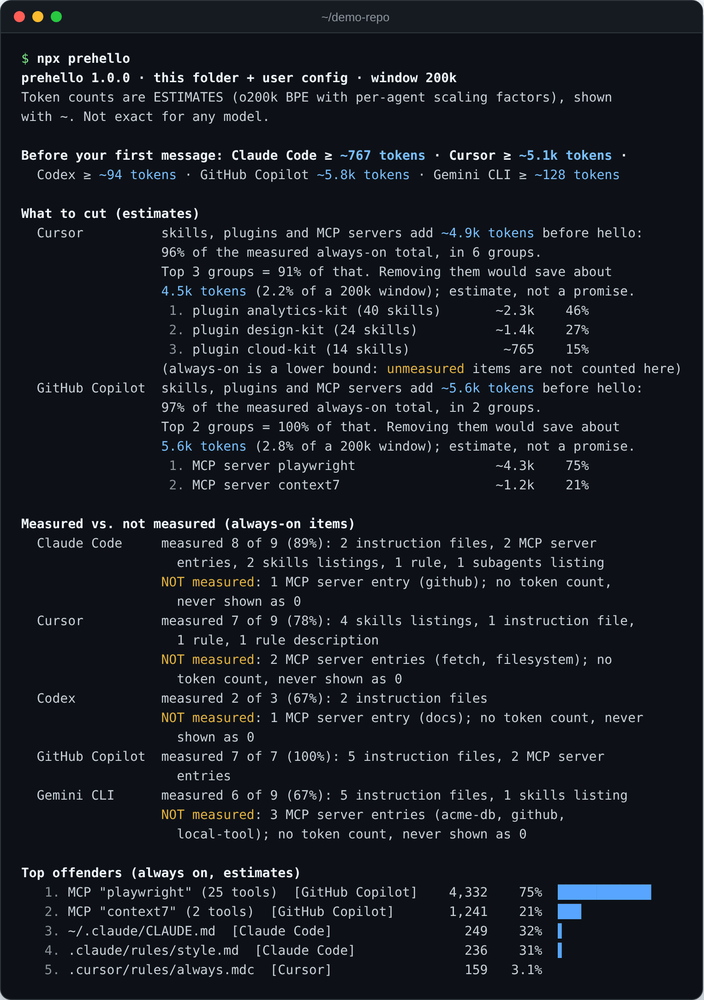
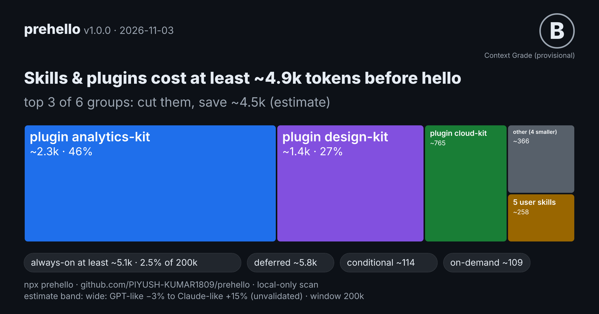
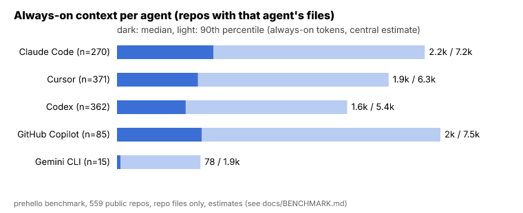
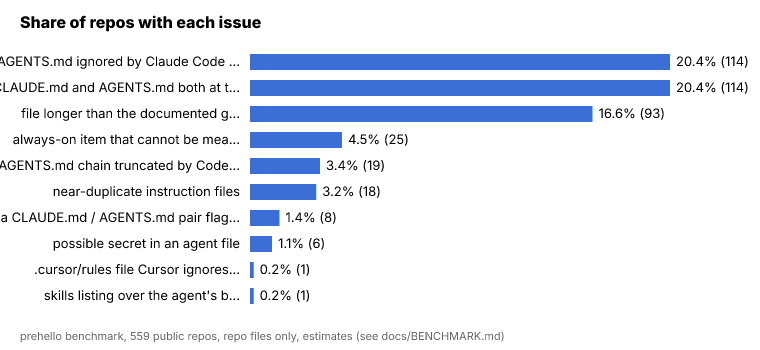
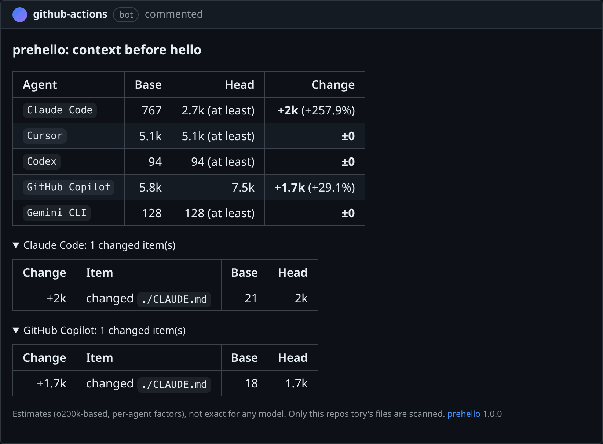

<h1 align="center">prehello</h1>

<p align="center"><b>See what your coding agent loads before you say hello, and what you could cut.</b></p>

<p align="center">
  <a href="https://github.com/PIYUSH-KUMAR1809/prehello/actions/workflows/ci.yml"></a>
  <a href="https://www.npmjs.com/package/prehello"></a>
  <a href="LICENSE"></a>
  
  
</p>

Every **Claude Code, Cursor, Codex, GitHub Copilot and Gemini CLI** session starts with rules, skills, plugin listings and MCP servers already
in the context window, before you type a word. **prehello** scans your repo and your user-level agent config and tells you
**how many tokens that is, which plugin or file is responsible, and roughly what removing the top few would save.**

- **Local and read-only.** No network, no telemetry, no API key, no child processes. Nothing leaves your machine.
- **Honest numbers.** Every count is an estimate (`~`) with a published error band. What it cannot measure is listed, never shown as 0.
- **Actionable.** A ranked "what to cut" list, a share card, a PR comment on every pull request, a badge, SARIF and a `--max-tokens` CI gate.

```sh
npx prehello                          # this folder plus your user-level agent config
npx prehello ~/code/your-project      # a specific project
npx prehello --card=card.png          # also write a PNG share card
```

Needs Node 22 or newer, on Linux, macOS or Windows. `npm install -g prehello` installs it as `prehello`.

## What it prints

<p align="center"></p>

<sub>A real run of prehello 1.0 on a demo setup built from the bundled test fixtures (`test/fixtures/`), not anyone's real machine.</sub>

Below this first screen come a per-agent breakdown (always-on / conditional / deferred / on-demand), findings, and a Context Grade
(a heuristic of this tool, not a standard). The full output is in [docs/REFERENCE.md](docs/REFERENCE.md).

> **Read the numbers as "what YOUR config adds".** The agent's built-in system prompt and tool definitions are not on disk, so no static
> scanner can see them. prehello's total is the part *you* control. For the exact live total in one Claude Code session, use `/context`.

**The share card** (`--card=card.png`) holds no paths or file contents:

<p align="center"></p>

## What 559 public repos load before hello

The [State of agent context 2026](docs/BENCHMARK.md) benchmark checked 2,041 public GitHub repos; 559 ship agent files. prehello ran on each with an
empty HOME, so only the repo's own files count.

- The median repo adds **~2.2k tokens** before hello. p90 is ~8.4k, the largest ~53k.
- **20.4%** have both CLAUDE.md and AGENTS.md at the root, so Claude Code ignores the AGENTS.md.
- **16.6%** have an instruction file longer than the agent's documented guideline; **3.4%** have an AGENTS.md chain Codex truncates at 32 KiB.
- Stars don't predict size (Spearman 0.05), but they do predict adoption: **47%** of 10k+ star repos ship agent files, vs **17%** at 20–99 stars.

<p align="center">
  
  
</p>

Data, scripts and how to reproduce it are in [`benchmark/`](benchmark/) and [docs/BENCHMARK.md](docs/BENCHMARK.md).

## A PR comment on every pull request

```yaml
# .github/workflows/prehello.yml
on: pull_request
permissions: { contents: read, pull-requests: write }
jobs:
  context-diff:
    runs-on: ubuntu-latest
    steps:
      - uses: actions/checkout@v4
        with: { fetch-depth: 0, persist-credentials: false }
      - uses: PIYUSH-KUMAR1809/prehello@v1
        with: { fail-above: 2k }   # optional
```

<p align="center"></p>

One sticky comment per PR, updated on every push. Fork PRs fall back to the job summary. Details, inputs and the README badge
(`--badge badge.json`, a shields.io endpoint) are in [docs/github-action.md](docs/github-action.md).

## How accurate is it?

Counts use the o200k tokenizer with per-agent factors from published measurements. Bands: Codex ±3%, Claude Code ±15%,
Cursor and Copilot −3% to +15% (model unknown), Gemini CLI −3% to +64% (unvalidated). Sources and caveats are in [docs/ACCURACY.md](docs/ACCURACY.md).
`prehello calibrate --file ctx.txt` compares the estimate with your own Claude Code `/context` reading, per category.

## Outputs

| You want | Run |
| --- | --- |
| The report in the terminal | `node dist/cli.js` (`--verbose` for per-item evidence) |
| A share card (PNG or SVG) | `--card=card.png` or `--card=card.svg` (write the name with `=`) |
| Something to paste into an issue, PR or Slack | `--markdown` (or `--markdown=report.md`, `--markdown-compact` for a PR comment) |
| GitHub code scanning / IDEs | `--sarif=prehello.sarif` |
| Machine-readable | `--json` (add `--redact` before sharing it: no paths or names) |
| A budget gate in CI | `--max-tokens 16k` (exit code 2 above it) |
| What a PR changes | `--save base.json` / `--save head.json`, then `prehello diff base.json head.json` (`--markdown`, `--fail-above 2k`) |
| A PR comment on every pull request | the GitHub Action: `uses: PIYUSH-KUMAR1809/prehello@v1` ([docs/github-action.md](docs/github-action.md)) |
| A README badge | `--badge badge.json` (shields.io endpoint JSON; see [docs/github-action.md](docs/github-action.md#badge)) |
| Check the estimate against Claude Code | `prehello calibrate --file ctx.txt` (paste `/context` output; see [docs/ACCURACY.md](docs/ACCURACY.md)) |
| Suggestions, changing nothing | `--fix` (dry run) |
| Count Cursor "User Rules" you paste in | `--paste-user-rules rules.txt` |
| Also count agent files inside test-fixture folders | `--include-fixtures` (skipped by default; see [docs/REFERENCE.md](docs/REFERENCE.md)) |

`node dist/cli.js --help` lists every flag. PNG cards need the optional package `@resvg/resvg-wasm`; if it is missing, prehello prints how to install it
and exits 1 without a stack trace, and the SVG card and everything else keep working.

## Agents covered

Claude Code, Cursor, Codex, GitHub Copilot (CLI and VS Code), Gemini CLI, and plain `AGENTS.md` files. What is scanned for each is in [docs/REFERENCE.md](docs/REFERENCE.md). Not yet: Windsurf, Cline.

## FAQ

**Does it send anything anywhere?** No. No network, no telemetry, no API key, no child processes. A test runs the CLI with a guard that blocks and records any
network, DNS or child-process attempt. It writes only the output files you name (`--card=`, `--json=`, `--markdown=`, `--sarif=`).

**Is the token count exact?** No, and it says so. It counts with the o200k tokenizer and applies a per-agent factor. The Claude factors come from
published `count_tokens` measurements (a small sample, see [docs/ACCURACY.md](docs/ACCURACY.md)), not from prehello's own runs, so every
total carries an error band and a `~`. `prehello calibrate` compares the estimate with your own Claude Code `/context` reading.

**Why is my total smaller than what `/context` shows?** `/context` also sees the built-in system prompt, built-in tool definitions and the conversation. prehello only sees what is on disk.

**Why not just use `/context`?** If you only use Claude Code and want the true number for one live session, do. prehello works before a session, covers Cursor, Codex, Copilot and Gemini CLI too,
runs in CI, and ranks *which plugin or skill folder* to remove.

**Does it start my MCP servers?** No. It lists their names and counts. Sizes come only from a small measured catalog (`spec/mcp-weights.json`, 7 servers) or a file you give it; every other server stays "unmeasured".

**Does it change my files?** No. `--fix` is a dry run that only prints suggestions.

**Can I trust the Context Grade?** It is a heuristic of this tool, not a standard. It is capped at B and marked provisional when something that always loads could not be measured. `node dist/cli.js explain grade` prints the rubric. `--no-grade` hides it.

**Why does it say "Skipped N fixture folders"?** A repo that tests agent tooling keeps sample `AGENTS.md`, `CLAUDE.md`, `.cursor/rules` and skills under `test/fixtures/` and similar. No agent loads those, so prehello skips such folders by default and says how many it skipped (only folders where it found agent files). `--include-fixtures` counts them; scanning a folder that is itself inside a fixtures folder never skips anything.

**Does it work on Windows?** Yes. CI runs the full suite on Ubuntu, Windows and macOS with Node 22, 24 and 26. See [docs/REFERENCE.md](docs/REFERENCE.md).

## Limitations

- Token counts are **estimates**; the Claude factors rest on about 10 published measurements, and Cursor's model is unknown (see [docs/ACCURACY.md](docs/ACCURACY.md)).
- The built-in system prompt, built-in tools, Cursor User and Team Rules (unless pasted), claude.ai connectors, hook output and anything injected at runtime are **never measured**.
- Loading rules come from the agents' public docs and announcements, not from their source, and were **not re-verified against live installs**; items where sources disagree are labelled `assumed`.
- Five agents plus `AGENTS.md` are covered (Copilot and Gemini CLI token factors are unvalidated), and MCP server sizes exist for just 7 servers.

Full list: [docs/REFERENCE.md](docs/REFERENCE.md).

## How it differs

Several small tools look at neighbouring problems. As of 2026-10-25, from each project's own npm, PyPI or docs page; **I read them, I did not run them**.
They overlap with prehello in places, so if one of them fits better, use it.

- **`/context`** (built into Claude Code): per Anthropic, it visualizes what is currently loaded into the context window and where it is being spent, for the live session.
- **ccusage**: its npm description is "Analyze coding (agent) CLI token usage and costs from local data", so it is about what past sessions used and cost, not what loads before a session.
- **ctxlint**: a linter for AI agent context files and MCP configs, catching broken paths, wrong commands and leaked secrets.
- **ctxweight** (npm, v0.1.0): describes itself as an X-ray of your agent's context, with health checks and token cost in one command.
- **ctxaudit**: audits "the invisible context tax" from skills, rules and instruction files (v0.1.0, PyPI).

What prehello focuses on: a per-plugin / per-skill-folder **cut list**, **unmeasured is never 0** (totals become lower bounds), a confidence label on every item
(`documented`, `observed`, `assumed`), a share card that holds no paths or file contents, and a CI gate. What it does **not** do: live sessions, dollar cost,
linting your instructions against your code, or exact token counts.

## Roadmap

Not yet: `--probe` (starting MCP servers to measure real schemas), history beyond two snapshots, `--apply` / `--patch`, Windsurf and Cline adapters,
Cursor Team Rules, a catalog beyond the 7 measured servers.

## Contributing, security, licence

Issues and PRs are welcome: see [CONTRIBUTING.md](CONTRIBUTING.md) (the ground rules are product promises: local, read-only, estimates labelled, no file contents in output).
Report vulnerabilities as described in [SECURITY.md](SECURITY.md). Changes are listed in [CHANGELOG.md](CHANGELOG.md).

MIT © 2026 Piyush Kumar
