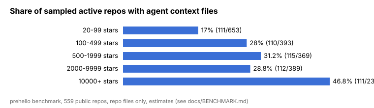
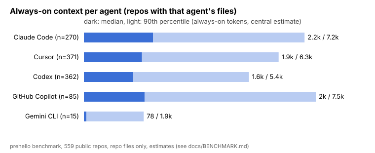
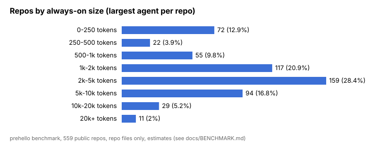
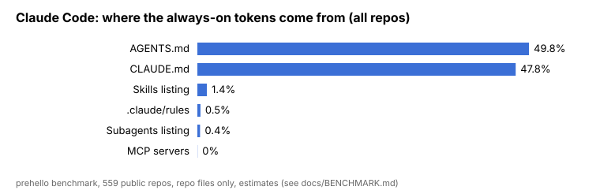
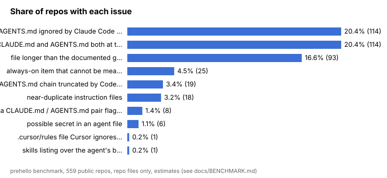
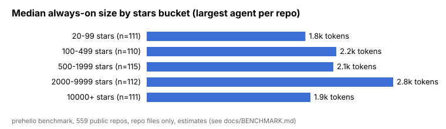

# State of agent context 2026

How many tokens do coding agents load from a repository before you type anything? We ran prehello on **559 public GitHub repositories** that ship agent context files and measured it.

All numbers below come from `benchmark/data/results.jsonl` (collected 2026-11-03). Everything is reproducible: see [How it was measured](#how-it-was-measured).

## Headline numbers

- **Median repo: 2,205 tokens** always-on before the first message (max over the five agents). p90: 8,374. Largest: 53,309.
- **Claude Code**, repos with their own Claude files (n=270): median **2,246**, p90 7,172. 53% load over 2k tokens, 22% over 5k, 7% over 10k.
- **20% of repos have both CLAUDE.md and AGENTS.md at the root.** Claude Code reads only CLAUDE.md, so the AGENTS.md is ignored by Claude unless imported.
- **17% have an instruction file longer than the agent's documented guideline** (finding F1). 122 single files exceed 200 lines, 30 exceed 500, 6 exceed 1,000.
- **3.4% have an AGENTS.md chain that Codex truncates at 32 KiB** (F12). Those instructions are silently cut.
- **1.1% (6 repos) contain something that looks like a secret** in an agent file (F9). The repos are deliberately not named: this finding is stored only as a count (`benchmark/data/aggregate.json`), never per repo, and the matched text and path are never recorded.
- **Stars don't predict size.** The Spearman correlation between stars and always-on tokens is 0.05.

## Which files repos ship

Share of the 559 repos:

| File | Repos | Share |
|---|---:|---:|
| AGENTS.md (any depth) | 379 | 67.8% |
| CLAUDE.md (any depth) | 251 | 44.9% |
| Skills folder (.claude, .agents, .cursor, .gemini) | 127 | 22.7% |
| .github/copilot-instructions.md | 73 | 13.1% |
| .cursor/rules | 24 | 4.3% |
| .mcp.json | 22 | 3.9% |
| .github/instructions | 21 | 3.8% |
| .claude/rules | 10 | 1.8% |
| GEMINI.md (any depth) | 9 | 1.6% |

AGENTS.md has become the common format. Among recently active repos, the share that ship any agent context file grows with popularity: 17% at 20–99 stars, 28–31% at 100–9,999, and **47% at 10,000+**. Across all buckets it's 27%.

## Always-on tokens per agent

Repos where that agent has its own files (Cursor, Codex and Copilot also read AGENTS.md):

| Agent | n | Median | p90 | Max | >2k | >5k |
|---|---:|---:|---:|---:|---:|---:|
| Claude Code | 270 | 2,246 | 7,172 | 53,309 | 53.3% | 21.9% |
| GitHub Copilot | 85 | 1,971 | 7,538 | 21,121 | 49.4% | 17.6% |
| Cursor | 371 | 1,884 | 6,331 | 29,138 | 48.0% | 17.3% |
| Codex | 362 | 1,600 | 5,366 | 11,081 | 42.8% | 11.9% |
| Gemini CLI | 15 | 78 | 1,944 | 3,713 | 13.3% | 0% |

The Gemini CLI sample is small (15 repos), so treat its numbers as anecdotal.

## Where the tokens come from

These are always-on tokens summed over all repos, as shares.

- **Claude Code:** AGENTS.md 49.8% (when it's imported or the only file), CLAUDE.md 47.8%, skills listing 1.4%.
- **Cursor:** AGENTS.md 95.2%, skills listing 3.4%, .cursor/rules 1.1%.
- **Codex:** AGENTS.md 94.3%, skills listing 5.2%.
- **GitHub Copilot:** AGENTS.md 56.8%, CLAUDE.md 37.5%, copilot-instructions.md 4.4%.

The main instruction file dominates everywhere. Skills cost little at startup because only their descriptions are listed.

## Common mistakes

| Finding | Repos | Share |
|---|---:|---:|
| AGENTS.md ignored by Claude Code (CLAUDE.md present) — F7 | 114 | 20.4% |
| File longer than documented guideline — F1 | 93 | 16.6% |
| Always-on item that can't be measured — F5 | 25 | 4.5% |
| AGENTS.md chain truncated by Codex — F12 | 19 | 3.4% |
| Near-duplicate instruction files — F2 | 18 | 3.2% |
| Possible secret in an agent file — F9 | 6 | 1.1% |

## Size by popularity

| Stars | n | Median | p90 |
|---|---:|---:|---:|
| 20–99 | 111 | 1,808 | 7,096 |
| 100–499 | 110 | 2,160 | 10,006 |
| 500–1,999 | 115 | 2,126 | 8,414 |
| 2,000–9,999 | 112 | 2,808 | 8,010 |
| 10,000+ | 111 | 1,865 | 7,253 |

## MCP

Only 26 repos (4.7%) configure project MCP servers, with a median of 1 server per repo. The most common are playwright (4) and context7 (3). For Claude Code, 71% of those MCP items can't be measured from the repo alone, because tool schemas only exist once the server runs. prehello never starts servers.

## How it was measured

1. **Sample** (`benchmark/collect.mjs`). GitHub repository search ran with seeded random creation-date windows in five star buckets: 20–99, 100–499, 500–1,999, 2,000–9,999 and 10,000+. Repos had to be non-fork, non-archived and pushed since 2026-08-01. Repos were taken in each bucket until about 110 had at least one agent context file. In total 2,041 repos were checked; 44 were skipped for size or clone failures.
2. **Checkout.** Clones were shallow, blob-less and sparse, with hooks, symlinks, submodules and LFS disabled. Only agent context paths, plus files they `@import`, were checked out. No repository code was ever run.
3. **Measure** (`benchmark/run.mjs`). The prehello 1.0 tree was run with `--json` and an **empty HOME**, so only the repository is counted, not anyone's user config or plugins. Every agent was forced, and a separate run recorded which agents auto-detect. 559 runs, 0 errors, 0 partial.
4. **Analyze** (`benchmark/analyze.mjs`). This step is deterministic and offline, and writes `summary.json` and the charts.

**Caveats:**
- Token counts are prehello estimates, with the error margins in [ACCURACY.md](ACCURACY.md).
- Real sessions add the system prompt, tools, user memory and plugins, none of which are counted here. These numbers are the repository's share only.
- "Always-on" for an agent includes files that agent reads even when the repo didn't write them for it (for example, Copilot reading CLAUDE.md).
- Prevalence is among recently active, searchable repos, not all of GitHub.

**Reproduce:** run `npm run build && node benchmark/collect.mjs && node benchmark/run.mjs && node benchmark/analyze.mjs`. Setting GITHUB_TOKEN is optional and makes search faster. `benchmark/data/sources.jsonl` pins every repo to a commit SHA.
